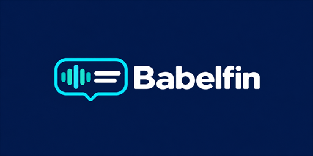
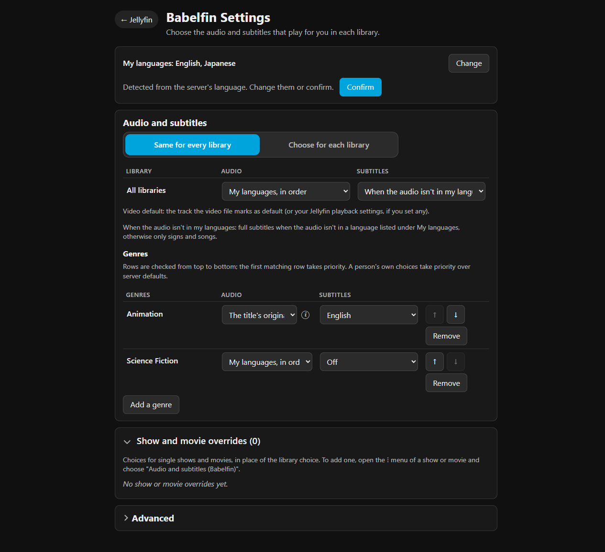
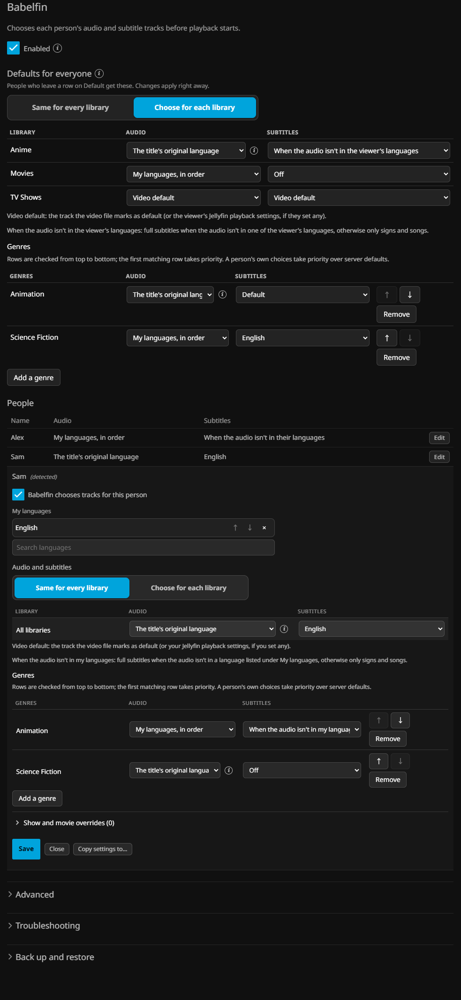
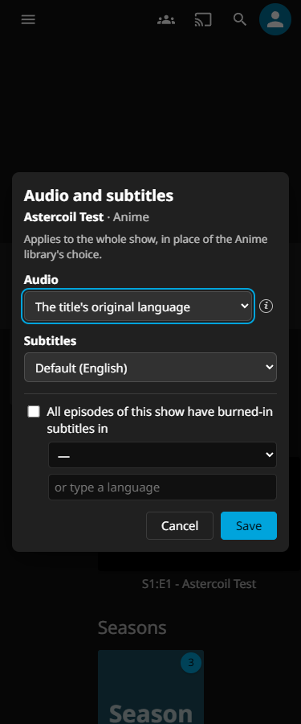

<p align="center"></p>

# Babelfin

Audio and subtitle preferences for each person, genre, library, show, and movie in Jellyfin.

Babelfin helps when episodes have tracks in different orders, a file marks Signs & Songs as its default subtitle, or people in one household want different languages. Set your preferences once and Babelfin matches them against the tracks available for each title.

**0.19.0.0 — First public beta (`v0.19.0-beta.1`)** by [WizardBal](https://github.com/WizardBal).

AI tools are used for development, review and all translations. Tested with Jellyfin 12.4 and the Jellyfin Android app on Google Pixel 11 Pro XL. Automated integration tests use Jellyfin Web on a disposable Jellyfin 12.2 test instance. Android TV, Swiftfin, Streamyfin and physical TVs have not been tested.

## Install

Babelfin targets Jellyfin's plugin ABI **12.0.0.0** and has automated integration tests on a disposable **Jellyfin 12.2.0** test instance. Back up your Jellyfin configuration before installing.

### Plugin catalog

Add this repository address in **Dashboard → Plugins → Repositories** (or **Manage Repositories**):

```text
https://github.com/WizardBal/Babelfin/releases/download/catalog/manifest.json
```

Install **Babelfin** from the plugin **Catalog**, restart Jellyfin, and confirm version **0.19.0.0** is **Active** in **Dashboard → Plugins**. Open Babelfin there to configure it.

Jellyfin checks the catalog for newer versions. New catalog installations allow automatic plugin updates; restart Jellyfin after an update. You can also install updates from the catalog manually. For a manual installation, follow the update instructions below.

### Manual installation

The [beta release](https://github.com/WizardBal/Babelfin/releases/tag/v0.19.0-beta.1) contains seven files:

| File | Purpose |
| --- | --- |
| `Babelfin-0.19.0.0.zip` | Plugin DLL, license, attribution, logo and Jellyfin metadata. |
| `Babelfin-0.19.0.0.zip.md5` | Checksum used by Jellyfin's plugin catalog. |
| `Babelfin-0.19.0.0.zip.sha256` | SHA-256 verification of the plugin ZIP. |
| `Babelfin-0.19.0.0-source.zip` | Corresponding source, embedded assets and build scripts. |
| `Babelfin-0.19.0.0-source.zip.sha256` | SHA-256 verification of the source archive. |
| `manifest.json` | Plugin catalog metadata, also published in the separate `catalog` release. |
| `NOTICE` | Upstream attribution and dependency inventory, also included in both ZIPs. |

1. Download the plugin ZIP and its `.sha256` from the same release. Verify the download before extracting it:

   ```sh
   # Linux
   sha256sum -c Babelfin-0.19.0.0.zip.sha256
   # macOS
   shasum -a 256 -c Babelfin-0.19.0.0.zip.sha256
   ```

   In Windows PowerShell, run `(Get-FileHash .\Babelfin-0.19.0.0.zip -Algorithm SHA256).Hash.ToLowerInvariant()` and compare it with the digest before the filename in `Babelfin-0.19.0.0.zip.sha256`. Continue when the digests match. A checksum detects damaged or mismatched downloads; it is not an independent signature.

2. Find the `plugins` folder inside Jellyfin's data directory. In Jellyfin 12.2, **Dashboard → Paths → Data** shows that directory; custom data paths override these defaults:

   | Setup | Plugins folder |
   | --- | --- |
   | Official Docker image (`jellyfin/jellyfin`) | `/config/plugins` inside the container; use the corresponding host folder mapped to `/config` |
   | linuxserver.io image | `/config/data/plugins` inside the container |
   | Debian/Ubuntu package | `/var/lib/jellyfin/plugins` |
   | Windows tray/service setup | `%ProgramData%\Jellyfin\Server\plugins` |
   | TrueNAS SCALE app | `plugins` inside the app's config storage host path; default user/group `568:568` |

   See Jellyfin's [server paths](https://jellyfin.org/docs/general/administration/configuration/), [container storage](https://jellyfin.org/docs/general/installation/container/) and [TrueNAS configuration](https://jellyfin.org/docs/general/installation/advanced/truenas/). Direct Windows launches can use `%LocalAppData%\jellyfin` instead; check **Paths** for the running server.

3. Create `Babelfin_0.19.0.0` inside the plugins folder. Extract the ZIP's five files directly into it: `Jellyfin.Plugin.Babelfin.dll`, `meta.json`, `logo.png`, `LICENSE` and `NOTICE`.
4. Make sure the account Jellyfin runs as can read that directory and its files. Docker uses the container's configured user. For the default TrueNAS user, run `chown -R 568:568 "/path/to/plugins/Babelfin_0.19.0.0"`, replacing the path with this plugin folder. If the app uses a custom user or group, use those IDs.
5. Restart Jellyfin and confirm **Babelfin 0.19.0.0** is **Active** in **Dashboard → Plugins**.
6. **Updating a manual install:** extract the new version into its own `Babelfin_<version>` folder next to the old version, then restart. In a Jellyfin 12.2 test, the new version became Active and Jellyfin removed the old plugin folder automatically. Settings remained outside those version folders. If you want to keep the old plugin files, move that folder out of the plugins folder before restarting. Confirm the new version is Active afterward.

You can add the catalog repository at any time to receive update notices.

## Set your preferences

1. In Jellyfin Web, open your avatar menu → **Babelfin Settings**.
2. Review **My languages** and confirm or change the detected languages.
3. Under **Audio and subtitles**, choose **Same for every library** or **Choose for each library**, set your choices, then **Save**.
4. Under **Genres**, add rows and move them up/down to set priority. The genres offered come from titles visible to your account.
5. For one show or movie, use its **⋮ → Audio and subtitles (Babelfin)** menu. Review or remove entries under **Show and movie overrides**.
6. Open **Advanced** for **Languages for subtitles**, accessibility preferences, **Remember track changes for**, and Jellyfin's previous-item track settings. Remembering changes depends on what the player reports. A track change made during playback is remembered once it has stayed selected for 10 seconds: a later progress report shows it, or playback stops with it selected after at least 10 seconds. A change reverted or replaced within 10 seconds is not remembered, including the brief "subtitles off" that Jellyfin Web reports while it restarts a stream. Track choices made before playback starts are remembered at once.

**Advanced → Track changes → Turn off Jellyfin's "based on previous item" track settings** is on by default for every person. While it is on, Babelfin turns off that person's Jellyfin **Set audio track based on previous item** and **Set subtitle track based on previous item**. With those Jellyfin settings on, Jellyfin Web and apps built on it (Jellyfin Desktop, Jellyfin Media Player and the Android app's web player) copy the previous episode's audio and subtitle tracks to the next episode, which replaces Babelfin's choice. Babelfin records the original values and puts them back when the switch is turned off, when Babelfin is turned off for that person or the server, and when Babelfin is uninstalled. Person settings stored in an older format are upgraded when first read, and that upgrade turns the switch on; turning it off afterwards is kept.

Audio options include a specific language, **My languages, in order**, and **The title's original language**. Original language comes from the title's metadata, inherited from its show for episodes.

Subtitle options include **When the audio isn't in my languages**, **Signs and songs only**, and **Always show subtitles**. You can also set accessibility preferences such as SDH. Requested tracks must exist in the file or as available external subtitles.

Audio and subtitles inherit separately. Personal show/movie choices and remembered changes take priority, followed by personal genre rows, personal library choices, administrator genre rows, and administrator library choices. Within genre rows, the first matching row that sets the field wins. The show/movie editor applies to a whole show or movie.

### Use settings from another app

Sign in to the same server and account in a browser and open Babelfin Settings. The standalone page is `{server-base-url}/Babelfin/app`; keep any server base path and omit `/web/`. Sign in to Jellyfin in that browser and origin first if needed.

Babelfin adds its menus to the server-served web client. Apps with their own interface or bundled web client may lack those menus. Their players may also ignore server track choices; use the app's own language preferences where necessary.

## Administrator setup

Open **Dashboard → Plugins → Babelfin**:

- **Enabled** controls server-wide selection.
- **Defaults for everyone** sets library and genre preferences. People's own choices take priority.
- **People** lets you review, edit or copy settings. **Advanced → New users** sets starting languages for new accounts.
- **Advanced → Apps** controls how reported clients' choices are handled and whether choices made before playback can be remembered. In **Use Babelfin's choice when playing the next episode** mode, a track an app carries over to the next episode is replaced whenever it differs from Babelfin's choice; changes made during playback reach the next episode through Babelfin's remembered track changes.
- **Troubleshooting → Check a title** explains a selection. **Activity** shows recorded events.
- **Back up and restore → Download all settings** exports readable settings and reports any skipped accounts by name and reason. An export with skipped accounts is incomplete; keep other backups and resolve the reported problems before relying on it. Preview imports before applying them.

**Reset all settings** first saves a recovery export. Review its report for skipped or failed accounts, their names and reasons, and whether server settings were reset. Skipped accounts are omitted from the backup and left unchanged. A failed Jellyfin remember-flag restoration can be reported after that person's settings have already been reset. Do not treat a partial export or reset backup as a full backup.

Jellyfin lists **Babelfin: report missing-item overrides** under **Dashboard → Scheduled Tasks**. It runs on a daily interval and does not run at startup; you can run it manually from that page. It reports references to missing items without removing overrides or burned-in subtitle flags. The scheduled task and manual report endpoints leave saved settings and recovery files unchanged. It skips active library scans and an empty or unavailable library. Check the server log for missing-reference counts and skipped-account reasons.

Track recognition supports editable commentary/full/SDH words and language-code aliases. Selection covers shows and movies; Live TV and music are outside its scope.

## App support

Tested with Jellyfin 12.4 and the Jellyfin Android app on Google Pixel 11 Pro XL. Automated integration tests use Jellyfin Web on a disposable Jellyfin 12.2 test instance. Android TV, Swiftfin, Streamyfin and physical TVs have not been tested.

Automated browser checks cover desktop, mobile and legacy layouts, plus keyboard navigation in Jellyfin Web's TV layout. Mobile sizes and TV keys are simulated; these checks do not verify a physical remote, native decoder or native app. Jellyfin Desktop, MPV Shim, webOS/Tizen and other native players also need app testing.

Babelfin depends on the track choices a player requests and reports. Without a device ID, choices made before playback are not remembered; normal Jellyfin token authentication supplies the device identity. A player can ignore server selections or report changes late. Current selection assumes text and image subtitle support and does not evaluate a device's direct-play audio compatibility, so it cannot promise to avoid transcoding. If another automatic track selector is installed, test with that selector disabled first, then test coexistence separately.

The Jellyfin Android app reports itself as "Jellyfin for Android". Babelfin lists that name with **Use Babelfin's choice when playing the next episode** and remembers its pre-play choices. A server upgrading from an earlier Babelfin version gets that row unless an administrator has already set one.

Some apps start playback without naming tracks, such as the Jellyfin Android app's built-in player. For those requests, Babelfin marks its audio choice as the person's own and gives its subtitle choice the highest subtitle score. Jellyfin's stream selection then keeps both, instead of switching to a default-flagged audio track or an equally ranked subtitle track. When the device cannot play the chosen audio codec, Jellyfin converts that track rather than picking another one.

If an app sends its original track choices again after Babelfin replaced them, Babelfin can't tell that from a new choice and may remember it.

In reports, include the app, its version and player mode, and whether it ran in a browser, emulator or physical device.

## Troubleshooting

If playback differs from your preferences:

1. Confirm Babelfin is enabled for the server and person, and save your choices.
2. Review **Show and movie overrides** and remembered changes.
3. In **Troubleshooting → Check a title**, select the same person/title and open **Why**. Compare the available languages, full/partial/SDH classification, forced/default flags, format, and burned-in subtitle flags.
4. Check **Activity** and the app-support table. In a [bug report](https://github.com/WizardBal/Babelfin/issues), include Jellyfin, app and Babelfin versions, player mode, expected/actual tracks, and a sanitized explanation.

Babelfin selects available tracks. A burned-in subtitle flag is a language declaration, not OCR or subtitle detection. Babelfin does not download, translate or generate subtitles; providers and downloads are managed separately by Jellyfin.

Before sharing logs, explanations or screenshots, remove credentials, account IDs, server addresses and media paths, and replace people's names and media titles with sample names.

**Reporting a problem:** open **Dashboard → Logs**, open the current log and copy the lines containing `[Babelfin]` from around the time of the problem. Include **Check a title** output for the affected title. Apply the redaction guidance above before sharing either output.

## Activity history and retained data

Babelfin keeps the newest **5,000** activity entries in memory, newest first. The list shows activity since Jellyfin last started and empties when Jellyfin restarts. Babelfin creates no activity files when recording or viewing this list. Deleting an account removes that person's entries from the list and blocks new entries for that account until it is restored or Jellyfin restarts.

The normal decision and settings events also appear in Jellyfin's own log with a `[Babelfin]` prefix. Per-title compatibility writes are Debug messages; their undo summary is logged at Information. Jellyfin manages its own log files. See **Dashboard → Logs** for earlier events.

Person settings backups and server backups are separate. Deleting a Jellyfin account retains its person settings file with a `.deleted-*` suffix. Uninstalling Babelfin leaves its settings and backups on disk.

Any existing `babelfin/pruned-overrides/` recovery exports are retained. They can contain account names and IDs, preferences and references to deleted titles, and do not expire automatically. The report-only task does not create or remove these files. Preview a recovery export under **Back up and restore** before importing it. Removing the entire `babelfin` data directory as described below also removes these exports.

Repaired-file backups (`users/*.json.repaired-*.bak`) and copy backups (`backups/copy-*.json`) are retained indefinitely; delete them once recovery is complete.

Babelfin does not read or write legacy `babelfin/activity.jsonl`, `babelfin/activity-recovery/` or `babelfin/deleted-users/` files. Existing files are left untouched and can be removed manually.

## Updates, disabling and removal

Before updating, download all Babelfin settings and back up Jellyfin's configuration and Babelfin data. Keep the previous plugin package for recovery.

To stop selection, use Babelfin's own server/person **Enabled** switch while the plugin is loaded. It restores recorded Jellyfin remember flags for that scope and keeps saved preferences. **Also save choices as Jellyfin's remembered tracks** is a separate compatibility setting; turn it off separately to undo those writes where Jellyfin still holds Babelfin's value.

For removal, uninstall through Jellyfin while Babelfin is loaded, then restart and check the logs. Cleanup attempts to restore remember flags and compatibility selections while respecting later external changes. Uninstall cleanup leaves each person's **Turn off Jellyfin's "based on previous item" track settings** switch as stored, so after a reinstall those Jellyfin settings are turned off again for people with the switch on. **Disabling Babelfin on Jellyfin's Plugins page and restarting** attempts the same restoration before shutdown. A crash or manual folder removal bypasses cleanup, so previously changed Jellyfin settings may remain. Restoration requires the plugin to be running and is best effort.

### Remove all Babelfin data

Uninstall through Jellyfin first so Babelfin can attempt to restore the Jellyfin settings it changed. Check the cleanup logs, then stop Jellyfin before removing files. For a complete removal, remove only Babelfin's files:

- Every `Babelfin_*` plugin directory under Jellyfin's plugin directory, including disabled or previous plugin copies there.
- `Jellyfin.Plugin.Babelfin.xml` under Jellyfin's plugin configuration directory (`plugins/configurations` in a standard installation).
- The entire `babelfin` directory under Jellyfin's data directory: user JSON files, `compat.json`, deleted-account settings copies, upgrade/reset backups, temporary files and any old activity data you retained.
- Downloaded exports and separate backup copies you retained outside Jellyfin's data directory.
- Babelfin's catalog entry under **Dashboard → Plugins → Repositories**, if no longer wanted.

Paths inside containers depend on the image and mounts. Check Jellyfin's startup log for its actual configuration/data directories. Do not remove shared plugin directories, Jellyfin's own databases, users or media. Keep backups until you have confirmed cleanup; removing backup copies is optional and irreversible.

## Screenshots

Jellyfin/Babelfin on the isolated test server, with synthetic accounts, genres and media:







## Development and testing

Advanced integrations can use the documented [HTTP API](docs/API.md).

See [testing and coverage](docs/TESTING-COVERAGE.md) for measured scope, reproduction commands and coverage limits.

Requires the **.NET 10 SDK pinned in [global.json](global.json)** (latest patch within that feature band). The checks use **Node.js 24**, as CI does, and **Python 3.9+**.

From the repository root:

```sh
dotnet build plugin/src/Jellyfin.Plugin.Babelfin/Jellyfin.Plugin.Babelfin.csproj -c Release --warnaserror
dotnet test plugin/tests/Babelfin.Engine.Tests/Babelfin.Engine.Tests.csproj -c Release
dotnet run --project plugin/bindtest/app/App.csproj -c Release
python -X utf8 tools/tests/ui-smoke/run.py
```

The binding check loads Jellyfin 12.2 assemblies. The UI smoke suites use fake DOMs and APIs; see their [instructions](tools/tests/ui-smoke/README.md). The [HTTP harness](plugin/harness/Program.cs) uses loopback, fake server services and a self-contained companion middleware fixture to check script injection, compression and caching together. These commands do not install anything on a server.

A corresponding-source archive contains the tracked tree and a `SOURCE.json` record with its commit, tree, intended tag and version. It includes the language input used by `tools/gen_languages.py`. To rebuild a source archive without Git metadata, pass its recorded commit as `-p:SourceRevisionId=COMMIT` when building. For a byte comparison with the release DLL, use a clean Git checkout of that commit and the same pinned SDK.

Release preparation from that clean checkout uses `tools/package.py` with the commit's timestamp and `tools/source_archive.py --commit COMMIT --tag v0.19.0-beta.1 --output OUTPUT_DIRECTORY`. Without `--output`, the package command writes to `dist/`. Packaging refuses a dirty source tree or a DLL whose assembly version, file version, hash or informational-version commit differs from the source. The metadata reader does not execute the plugin DLL. Neither command publishes anything. The binding checker accepts `--source-commit COMMIT` after the plugin output folder to check the DLL's informational version.

See [contribution and translation instructions](CONTRIBUTING.md).

## License

Copyright (c) 2026 WizardBal. Licensed under the GNU General Public License version 3 only (`GPL-3.0-only`). See [LICENSE](LICENSE) and [NOTICE](NOTICE) for the upstream inventory and attribution.

The GPL permits use, modification, forks and commercial use. When distributing Babelfin or a modified version, preserve the required notices and provide the corresponding source under the GPL, including the scripts needed to build and install it. Releases include a corresponding-source archive tied to the same source commit as the binary. No paid commercial license is required. These notices do not claim legal clearance for third-party rights.
